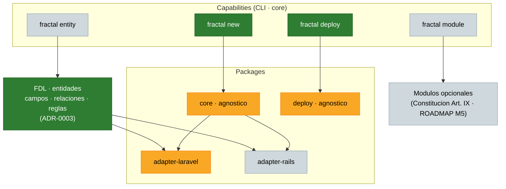

# Mapa de Progreso — Fractal

**Versión:** 1.0.0
**Estado:** Draft
**Última revisión:** 2026-11-12 — FRA-102 (PR #117) mergeado y Done.
El pack de convenciones (`AGENTS.md`, `fractal/domain.fdl.json`,
`fractal/prompts/add-entity.md`, `fractal fdl check`) cubre AC-1..AC-8 de
SPEC-0007; el spec queda en curso porque su DoD §9 no está cumplida (sigue
en «En revisión»). M2 sigue abierto. SPEC-0032 está **Implementado** y la
DoD §9 tildada. M1.5 sigue cerrado (FRA-82..FRA-88; QA e2e #113 / FRA-94
PASS en `081f2e2`). `fractal entity` sigue pendiente. El Diagrama 1
(milestones) y el Diagrama 2 (capacidades y módulos) se regeneran desde
[`progress.json`](progress.json) (SPEC-0031).

---

Este documento es un **pantallazo visual del avance del proyecto**: un mapa para
ubicarse en el día a día y ver, de un vistazo, cómo va Fractal en su camino de
0 → producción. No reemplaza a la documentación de fondo — la complementa.

- La visión completa vive en [`VISION.md`](VISION.md).
- Los principios innegociables, en [`CONSTITUTION.md`](CONSTITUTION.md).
- **La fuente de verdad que pintan los diagramas es [`progress.json`](progress.json)**
  (SPEC-0031). [`ROADMAP.md`](ROADMAP.md) y los milestones de Linear se mantienen
  en paralelo. Si este mapa y ROADMAP discrepan, el diagrama sigue a
  `progress.json`; alinear ROADMAP es un cambio aparte.

---

## Nota de convención

Este documento introduce diagramas **Mermaid** (se renderizan directamente en
GitHub). Es una convención nueva en el repo: hasta ahora los diagramas eran
ASCII (ver, por ejemplo, [`VISION.md`](VISION.md) §5 y
[`ARCHITECTURE_WORKFLOW.md`](ARCHITECTURE_WORKFLOW.md) §1). El cambio es
deliberado: Mermaid permite **colorear los nodos por estado**, que es
justamente lo que este mapa necesita.

---

## Leyenda de estados

- ✅ **Completado**
- 🟡 **En curso**
- ⬜ **Pendiente**

> ✅ y ⬜ son los mismos glifos que usa [`ROADMAP.md`](ROADMAP.md). 🟡 **en curso**
> es un estado intermedio que introduce este mapa, para reflejar trabajo ya
> arrancado que todavía no cumple su Definition of Done.

---

## Diagrama 1 — Avance por milestone (M0 → M6)

> **Generado automáticamente** desde [`progress.json`](progress.json) con
> `fractal status --write` (o el dev-tool `pnpm progress` /
> `scripts/progress-map.js`, un wrapper fino sobre el mismo núcleo). No editar a
> mano el bloque entre los marcadores: se sobrescribe. El **Diagrama 2**
> (capacidades y módulos) también se genera automáticamente desde
> [`progress.json`](progress.json) (SPEC-0031 AC-3).
>
> La CI del repo corre `fractal status --check` (modo dry-run, no escribe) y
> **bloquea el merge** si este bloque quedó desactualizado respecto de
> `progress.json`: regenerá con `fractal status --write` y commiteá el cambio
> (SPEC-0031 AC-4, FRA-45).

```mermaid
flowchart LR
    M0["M0 · Fundaciones<br/>reglas, docs y CI base"]
    M1["M1 · Esqueleto vertical<br/>new + deploy = app online"]
    M1.5["M1.5 · Wizard v2<br/>wizard code-first y modular"]
    M2["M2 · FDL y generación de entidades por el agente<br/>convenciones y prompts para el agente"]
    M3["M3 · Autenticación y autorización<br/>roles, OAuth, 2FA"]
    M4["M4 · Adapter Rails<br/>multi-target verificado"]
    M5["M5 · Módulos avanzados<br/>módulos instalables"]
    M6["M6 · Operación<br/>backups, monitoreo, upgrade"]

    M0 --> M1 --> M1.5 --> M2 --> M3 --> M4 --> M5 --> M6

    classDef done fill:#2e7d32,color:#fff,stroke:#1b5e20;
    classDef curso fill:#f9a825,color:#000,stroke:#f57f17;
    classDef pend fill:#cfd8dc,color:#000,stroke:#90a4ae;

    class M1,M1.5 done;
    class M0,M2 curso;
    class M3,M4,M5,M6 pend;
```

<!-- progress-map:auto:start -->

<!-- progress-map:auto:end -->

**Lectura honesta del estado actual** (contrastada con el código, los
workflows de CI y [`progress.json`](progress.json) en master):

- **M0 🟡** — Fundaciones casi completas: ADRs, docs, lint de acoplamiento,
  monorepo y SPEC-0031 ✅. La CI del repo está en
  [`.github/workflows/ci.yml`](../.github/workflows/ci.yml): `fractal status
  --check`, tests + typecheck, `pnpm lint`, lint de acoplamiento y e2e Laravel
  (PHP 8.2); Node queda fijo en 22. Falta la **matriz de versiones**:
  ningún workflow declara `strategy.matrix` (`deploy-e2e.yml` usa PHP 8.3 en un
  job aparte). Por esa matriz el milestone sigue en curso.
- **M1 ✅** — Esqueleto vertical cerrado el 2026-10-26 (FRA-81, decisión de
  Diego): SPEC-0001, SPEC-0002 y SPEC-0003 **Implementado**. El e2e real
  `fractal new` + `fractal deploy` (FRA-73/76) y el QA PASS post-merge #93
  en master `2df1d60` cubren el DoD que la auditoría del 2026-10-14 había
  reabierto.
- **M1.5 ✅** — Wizard v2 cerrado. SPEC-0032 está **Implementado** (#114,
  2026-11-11) y la DoD §9 está tildada. Las siete tareas (FRA-82..FRA-88)
  están mergeadas en master. El QA e2e post-merge de #113 (FRA-94) dio PASS
  en master `081f2e2`.
- **M2 🟡** — SPEC-0004 (lenguaje FDL) y SPEC-0006 (contrato del adapter) están
  **Implementado**: el lenguaje vive en `packages/core/src/fdl` y `fractal new`
  ya genera las tres topologías contra el contrato. SPEC-0005 quedó absorbido
  en SPEC-0004. FRA-102 (PR #117, merge `d563b5f`) está Done: `fractal new`
  deja el pack (`AGENTS.md`, `fractal/domain.fdl.json`,
  `fractal/prompts/add-entity.md`) y `fractal fdl check` valida el contrato
  (AC-1..AC-8, con tests). SPEC-0007 queda **en curso**: el documento sigue
  en «En revisión» (DoD §9 pide la aprobación de Diego y marcarlo
  **Implementado**, decisión que el propio spec deja fuera de la
  implementación) y las preguntas de §8 siguen abiertas. La implementación
  siguió los defaults de §8 (convenciones en el adapter, `fractal fdl check`,
  un solo prompt, `AGENTS.md` como plantilla del adapter); queda sin decidir
  si el descarte del motor de templating amerita un ADR. El ROADMAP deja M2
  abierto mientras SPEC-0007 no cierre. La salida de CRUD desplegable queda
  en el agente del proyecto, que la escribe siguiendo el pack.
- **M3–M6 ⬜** — Pendientes.

---

## Diagrama 2 — Mapa de capacidades y módulos

> **Generado automáticamente** desde [`progress.json`](progress.json) (bloque
> `capacidades`) con `fractal status --write` (o `pnpm progress` /
> `scripts/progress-map.js`, wrapper fino sobre el mismo núcleo). No editar a
> mano el bloque entre los marcadores: se sobrescribe.

<!-- progress-map:diagrama2:start -->

<!-- progress-map:diagrama2:end -->

Cómo leerlo:

- **`fractal new` y `fractal deploy` ✅** — M1 cerrado (FRA-81): specs
  **Implementado**, e2e real + QA PASS en master `2df1d60`.
- **`fractal entity` ⬜** — pendiente. El CLI de master registra `new`, `deploy`
  y `status` (`packages/core/src/cli.ts`). En `docs/specs/` no hay un spec de
  esa capability.
- **FDL ✅** — lenguaje v0 entregado: tipos, parser, validador y diagnósticos
  en `packages/core/src/fdl`, guía `docs/guides/fdl.md`, SPEC-0004
  **Implementado** (SPEC-0005 absorbido). El nodo cubre el lenguaje de ADR-0003
  (entidades, campos, relaciones, reglas). En M2, FRA-102 ya entrega el pack
  y `fractal fdl check`; SPEC-0007 sigue en curso (DoD §9 sin cumplir).
- **`fractal module` y módulos ⬜** — módulos opcionales, planificados para M5
  (ver [`CONSTITUTION.md`](CONSTITUTION.md) Artículo IX).
- **`core` y `deploy` 🟡** — packages agnósticos en construcción; **adapter-laravel
  🟡** como target de referencia; **adapter-rails ⬜**, target de validación (M4).

---

## Tabla de trazabilidad

Milestone → specs → estado en [`progress.json`](progress.json) → milestone de
Linear. Los diagramas y esta tabla salen de ese archivo (SPEC-0031).
[`ROADMAP.md`](ROADMAP.md) se mantiene aparte.

| Milestone | Specs / ítems | Estado (progress.json) | Milestone en Linear |
|---|---|---|---|
| M0 — Fundaciones | ADR-0002/0003/0004/0006/0007 ✅, lint de acoplamiento ✅, monorepo ✅, SPEC-0031 ✅, CI (lint, tests, typecheck, e2e) ✅, **matriz de versiones** ⬜ | 🟡 (falta la matriz de versiones) | M0 — Fundaciones |
| M1 — Esqueleto vertical | SPEC-0001, SPEC-0002, SPEC-0003 **Implementado** ✅ | ✅ (FRA-81, Diego 2026-10-26; QA PASS #93) | M1 — Esqueleto vertical |
| M1.5 — Wizard v2 | SPEC-0032 **Implementado** ✅ (DoD §9 tildada, #114); FRA-82..FRA-88 mergeados; QA PASS #113 en `081f2e2` | ✅ | M1.5 — Wizard v2 |
| M2 — FDL y generación de entidades por el agente | SPEC-0004 **Implementado** ✅, SPEC-0005 absorbido ✅, SPEC-0006 **Implementado** ✅; SPEC-0007 🟡 — FRA-102 / #117 Done (pack AC-1..AC-8); falta aprobación, marcado Implementado y cierre de §8 | 🟡 | M2 — FDL y generación de entidades por el agente |
| M3 — Autenticación y autorización | SPEC-0014, SPEC-0015, SPEC-0016 | ⬜ | M3 — Autenticación y autorización |
| M4 — Adapter Rails | SPEC-0017 … SPEC-0021 | ⬜ | M4 — Adapter Rails |
| M5 — Módulos avanzados | SPEC-0022 … SPEC-0026 | ⬜ | M5 — Módulos avanzados |
| M6 — Operación | SPEC-0027 … SPEC-0030 | ⬜ | M6 — Operación |

> Recordatorio: un spec **Aprobado** no es un spec **Implementado**. El estado
> de este mapa es el de `progress.json`. SPEC-0032 está **Implementado** en
> `docs/specs/0032-wizard-v2-code-first-modular-arms.md` (#114, 2026-11-11) y
> la DoD §9 está tildada. Queda sin tildar el ítem de sincronizar
> `docs/progress.json` y este mapa vía `fractal status --write` (lo aplica
> Fractal QA). M1.5 figura ✅ porque FRA-82..FRA-88 están mergeados y el QA
> e2e post-merge de #113 dio PASS. SPEC-0007 no está **Implementado**: sigue
> «En revisión» en `docs/specs/0007-convenciones-y-prompts-para-generacion.md`.
> En `progress.json` figura en curso porque FRA-102 cubre AC-1..AC-8 y la
> DoD §9 todavía no (aprobación de Diego, marcado Implementado, §8).

---

## Roadmap de este documento (siguiente iteración)

Esta es una **primera versión**, pensada para robustecerse:

- Más detalle por etapa: sub-nodos por spec dentro de cada milestone.
- Entidades y módulos concretos a medida que se definan por spec (hoy el mapa
  trabaja a nivel de capability y concepto).
- Posible **generación automática** del diagrama desde ROADMAP.md y/o los
  milestones de Linear, para que el mapa deje de actualizarse a mano y no pueda
  quedar desincronizado de la fuente de verdad.
